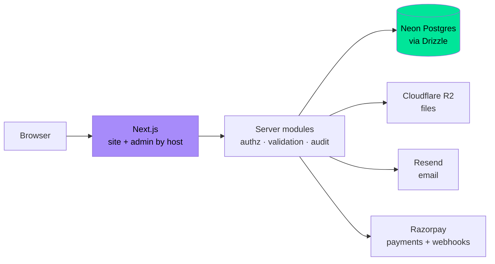

<div align="center">




**A white-label software-studio website and digital-product marketplace, with a full admin command centre.**

[Live site](https://crestlinetechnologies.in) · [Architecture](diagrams/system-architecture.md) · [Engineering blueprint](#engineering-blueprint)

      

</div>

CodeKraft is a **product by Crestline Technologies**. It replaces the spreadsheets, chat threads and manual payment checks a small studio runs on with one system: a public storefront, a customer portal, and an admin command centre. It was designed spec-first (BRD to SRS to screen specs) and built with AI coding agents under strict architectural rules, then hardened for production.

## What it does

| Area | Highlights |
|---|---|
| **Storefront** | Product catalog, offerings, blog, SEO, live theme studio |
| **Customer portal** | Orders, downloads, licences, invoices, subscriptions |
| **Payments** | Razorpay checkout and webhooks, coupons, quotes, multi-currency (FX) |
| **Finance** | Append-only ledger, reports, automatic partner allocations |
| **Admin command centre** | 22-widget dashboard, leads and follow-ups, guided product editor |
| **Governance** | Role-based access, team invites, second-approval on sensitive actions, audit log, feature flags |
| **AI** | Built-in AI assistant for admin workflows |

## Engineering at a glance

- **~1,000 TS/TSX source files, 147 pages, 26 API routes, 540+ test files**
- **Modular domain layer** (`src/modules/*`): finance, payments, orders, entitlements, approvals, invoices, auth, chat, media and more
- **Security by design:** server-side authorization everywhere, approvals for money-moving actions, immutable ledger entries
- **Quality gates in CI:** lint, typecheck, Vitest (unit and integration against real Postgres), Playwright e2e (desktop and mobile, site and admin), Lighthouse CI and bundle-size budgets
- **Observability:** Sentry on server, edge and client
- **Coverage thresholds enforced per module** (for example 100% on authorization and money math)

## Stack


Next.js 15 (App Router) · React 19 · TypeScript · Tailwind CSS 4 · Zod · Drizzle ORM · Neon Postgres · Better Auth (Google sign-in) · Cloudflare R2 · Resend · Razorpay · Sentry · Vitest · Playwright · pnpm · Vercel

## Architecture



Full diagrams: [`diagrams/`](diagrams/) (61 Mermaid diagrams covering system, data, payments and delivery).

## How it was built

Specification first, agents second. Every decision is logged in [`discovery/00-DECISION-LOG.md`](discovery/00-DECISION-LOG.md); every screen has a spec; work was split into dependency-ordered phases with tests gating each one. Built in personal time by [Yash Bankar](https://github.com/yashbank) at Crestline Technologies, using Claude Code and other AI agents under human-owned architecture and review.

---

<a id="engineering-blueprint"></a>
# CodeKraft — Engineering Blueprint

Premium software-studio website + company-owned digital-product marketplace, specified end to end for AI-assisted implementation.

**Continuing in Antigravity or another agent IDE?** Read [`ANTIGRAVITY-START.md`](ANTIGRAVITY-START.md) first, then [`AGENT-RUNBOOK.md`](AGENT-RUNBOOK.md).

**Start here for the spec:** [`MASTER_SPEC.md`](MASTER_SPEC.md) — the canonical entry point, terminology, design rules, document map and resolution table.

## Repository layout

| Path | What it is |
|------|------------|
| `CODECRAFT_INITIAL_SPEC.md`, `ClaudePrompt.md` | Original founder inputs (historical; the brand is **CodeKraft**) |
| `discovery/00-DECISION-LOG.md` | Every decision (D-), assumption (A-), risk (R-), rejection (X-) with sources |
| `discovery/01-REQUIREMENTS-BASELINE.md` | Approved requirements baseline (BR-01…BR-18, roles, models, scope) |
| `MASTER_SPEC.md` | Canonical spec: terminology, non-negotiable rules, doc map, resolutions |
| `docs/01–13` | BRD, PRD, SRS, Solution Architecture, Database, API, UX/UI, Design System, Security, QA, SEO/Performance, DevOps, Roadmap |
| `diagrams/` | 61 Mermaid diagrams: system, database, user/admin flows, payment, revenue, delivery |
| `ui/` | Sitemap, 61 screen specs (`screens/user`, `screens/admin`), Theme 1 and Theme 2 token sheets |
| `implementation/` | Dependency-aware master plan, phase files P1–P9 (release 1) and V1.1, progress board, issues |
| `prompts/` | Orchestrator prompts for Antigravity and Claude Code |
| `CHANGELOG.md` | Documentation and implementation change history |

## Quick start (development)

```
nvm use                # Node 22 (.nvmrc)
corepack enable pnpm   # pnpm 12 (packageManager)
pnpm install
cp .env.example .env.local
pnpm db:local          # Postgres 17 without Docker (or: docker compose up -d postgres)
pnpm db:migrate && pnpm db:seed
pnpm dev               # site http://localhost:3000, admin http://admin.localhost:3000
pnpm lint && pnpm typecheck && pnpm test && pnpm build
```

`pnpm db:local` downloads Postgres binaries once and keeps data in `.pg/`. On machines with Docker, `docker compose up -d postgres` (add `--profile storage --profile mail` for MinIO and Mailpit) is equivalent.

## Testing

Harness per `docs/10-QA-TEST-STRATEGY.md` (task P1.9). Everything runs locally without Docker.

| Command | What it runs |
|---------|--------------|
| `pnpm test` | Vitest: `unit` project (jsdom, `tests/unit/**` + `tests/property/**`) and `integration` project (node, `tests/integration/**`, serial) |
| `pnpm test:unit` / `pnpm test:integration` | one project only |
| `pnpm vitest run --coverage` | same, with v8 coverage and the thresholds below enforced |
| `pnpm e2e` | Playwright; starts `pnpm dev` (or `pnpm build && pnpm start` when `CI=1`) on port 3000 and runs `tests/e2e/**/*.spec.ts` under the projects `site`, `site-mobile` (Pixel 7), `admin`, `admin-mobile`. `E2E_FULL=1` adds WebKit, Firefox and Mobile Safari (nightly `@full` matrix, docs/10 §10) |
| `pnpm build && pnpm size` | `size-limit` on the first-load chunks of `/` (`.size-limit.json`, ≤ 200 KB gzip, docs/10 §9) |
| `pnpm build && pnpm lhci` | Lighthouse CI: starts `pnpm start`, 3 mobile runs per URL, asserts docs/11 §B10 (`lighthouserc.cjs`; `LHCI_BASE_URL` targets a deployed URL instead) |

**Integration database.** `tests/setup/global-db.ts` provides one Postgres for the whole run and tears it down afterwards. It picks, in order: `DATABASE_URL_TEST` if set (CI `services: postgres`, or the compose Postgres); otherwise Testcontainers `postgres:16-alpine` when `docker info` succeeds; otherwise embedded Postgres 17 (`tests/setup/embedded-pg.ts`, same binaries as `pnpm db:local`) on a free port in a temp directory. `CODEKRAFT_TEST_DB=embedded` skips the Docker probe. `citext` and `pgcrypto` are created on every path. Tests use `getTestDb()`, `withRollback()` and `truncateAll()` from `tests/setup/db.ts`.

**Hosts in e2e.** The site and admin apps are one Next server told apart by host. The `admin*` Playwright projects use `baseURL=http://admin.localhost:3000`; browsers and macOS/Linux resolvers map `*.localhost` to `127.0.0.1`, so no `/etc/hosts` entry is needed. Override with `E2E_SITE_URL` / `E2E_ADMIN_URL`.

**Coverage thresholds** (`vitest.config.ts`, docs/10 §12; lines / branches / functions): global 80 / 70 / 80; `modules/{finance,approvals,payments,entitlements,invoices,orders}` 95 / 90 / 95; `modules/{chat,media,auth}` 90 / 80 / 90; `authz` and `lib/money` 100 / 100 / 100; `components/**` 60 / 50 / 60. `src/app/**`, `src/emails/**`, `src/pdf/**`, stories and `tests/**` are excluded.

**Bundle budgets.** `.size-limit.json` currently checks the `/` first-load JS (200 KB), its CSS (40 KB) and the polyfill chunk. `size-limit` fails on a glob that matches nothing, so the `three-hero` (≤ 600 KB), `chapter-scroller` and `pdf-viewer` entries of docs/11 §B2 are added when those chunks exist (P7).

**Cleanup.** If a run is interrupted, check for a leftover dev server with `pgrep -fl "next dev"` and remove `test-results/`, `playwright-report/`, `.lighthouseci/` as needed (all git-ignored).

## Reading order for implementers
1. `MASTER_SPEC.md`
2. `discovery/01-REQUIREMENTS-BASELINE.md`
3. `docs/04-SOLUTION-ARCHITECTURE.md` → `docs/05-DATABASE-DESIGN.md` → `docs/06-API-SPECIFICATION.md`
4. `docs/09-SECURITY-DESIGN.md`, `docs/10-QA-TEST-STRATEGY.md`
5. `implementation/IMPLEMENTATION-MASTER-PLAN.md`, then the current `PHASE-xx.md`
6. Everything else on demand from the document map.

## Founder actions before release 1 goes live
- Buy the domain and verify it with Resend (customer email cannot be sent otherwise).
- Create Anthropic, Resend, Cloudflare R2, Neon, Umami, Turnstile and Sentry accounts (all free tiers) and add keys per `docs/12`.
- Provide the CodeKraft UPI VPA and bank details for the manual payment provider.
- Provide legal page copy or approve the placeholder drafts.
